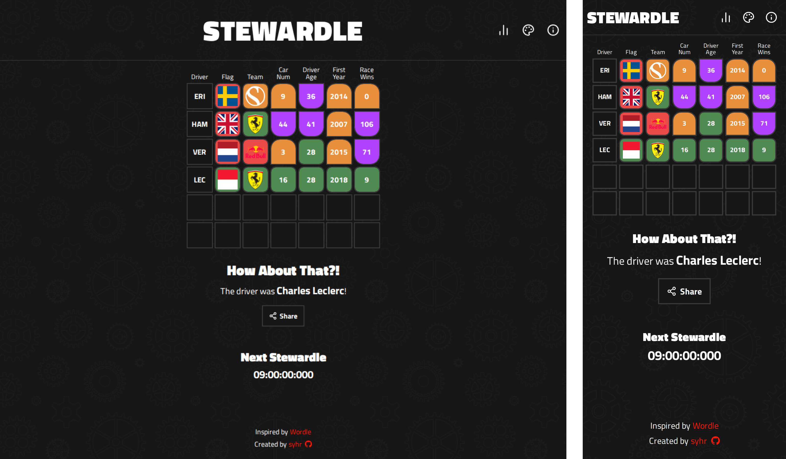

<a name="readme-top"></a>
[![Contributors][contributors-shield]][contributors-url]
[![Forks][forks-shield]][forks-url]
[![Stargazers][stars-shield]][stars-url]
[![Issues][issues-shield]][issues-url]
[![Docker Pulls][docker-shield]][docker-url]
[![MIT License][license-shield]][license-url]

<!-- PROJECT LOGO -->
<div align="center">
  <a href="https://stewardle.com/">
    
  </a>
  <h3 align="center">Stewardle</h3>
  <p align="center">
    A Wordle-inspired game designed for the web. Players must guess the F1 Driver of the Day using statistics retrieved from the Jolpica API. Built with TypeScript, Hono and Svelte.
    <br />
    🌐 <a href="https://stewardle.com/">View Demo</a>
    ·
    🐛 <a href="https://github.com/ssyyhhrr/stewardle/issues">Report Bug</a>
    ·
    ✨ <a href="https://github.com/ssyyhhrr/stewardle/issues">Request Feature</a>
  </p>
</div>

---

<!-- TABLE OF CONTENTS -->
<details>
  <summary>Table of Contents</summary>
  <ol>
    <li><a href="#about-the-project">About The Project</a></li>
    <li><a href="#self-hosting">Self-hosting</a></li>
    <li><a href="#contributing">Contributing</a></li>
    <li><a href="#license">License</a></li>
    <li><a href="#contact">Contact</a></li>
  </ol>
</details>

---

<!-- ABOUT THE PROJECT -->

<a name="about-the-project"></a>

## 🏎️ About The Project

<p>
  
</p>

Stewardle is a daily guessing game for Formula 1 fans. Every day at midnight UTC a new driver is picked from everyone with a permanent car number, and you have six guesses to find them. Each guess is scored on six clues:

- **Flag:** green for the same nationality.
- **Team:** green for the same current team, hatched yellow if the answer used to drive for your guess's team.
- **Car number, age, first year and race wins:** green if equal, otherwise an arrow pointing towards the answer.

Win to keep your streak, then share the emoji grid. The game works on phones and desktops, can be installed as an app, and keeps your statistics in the browser. It has light and dark themes (following your device unless you pick one) and a high-contrast mode in Settings. The answer stays on the server until the game is over.

---

<!-- SELF-HOSTING -->

<a name="self-hosting"></a>

## 🐳 Self-hosting

A Docker image is available on [Docker Hub](https://hub.docker.com/r/syhr/stewardle) (`latest`, plus one tag per commit to `main`).

```sh
docker run -d --name stewardle -p 3000:3000 -v stewardle-data:/data --restart unless-stopped syhr/stewardle
```

Or with Docker Compose:

```yaml
services:
  stewardle:
    image: syhr/stewardle
    container_name: stewardle
    ports:
      - "3000:3000"
    volumes:
      - stewardle-data:/data
    restart: unless-stopped
volumes:
  stewardle-data:
```

- **First start** fetches driver data from api.jolpi.ca. It retries for about five minutes, then exits so Docker can restart it. The roster refreshes every night at 23:30 UTC.
- **`/data`** holds `history.json` (past answers: back it up), `roster.json` and `secret`.
- **Put a reverse proxy in front** for HTTPS, at the root of the site. `GET /healthz` reports health.
- **Settings** are environment variables, all optional:

| Variable              | Default                             | Meaning                                                                             |
| --------------------- | ----------------------------------- | ----------------------------------------------------------------------------------- |
| `PORT`                | `3000`                              | Listening port                                                                      |
| `HOST`                | `0.0.0.0`                           | Listening address                                                                   |
| `DATA_DIR`            | `/data` in the image                | Where the game keeps its state                                                      |
| `STEWARDLE_SECRET`    | generated into `DATA_DIR/secret`    | Key that signs players' games, at least 32 characters                               |
| `JOLPICA_BASE_URL`    | `https://api.jolpi.ca/ergast/f1`    | Driver data source; `npm run fake-jolpica` serves recorded data for local use       |
| `WIKIDATA_SPARQL_URL` | `https://query.wikidata.org/sparql` | Where drivers' dates of death come from; if it fails, the last known dates are kept |

To run it without Docker: `npm ci && npm run build && npm start` on Node 24 or newer.

---

<!-- CONTRIBUTING -->

<a name="contributing"></a>

## 🤝 Contributing

If you have a suggestion that would make this better, please fork the repo and create a pull request. You can also simply open an issue with the tag "enhancement".

Don't forget to give the project a star! Thanks again!

1. Fork the Project
2. Create your Feature Branch (`git checkout -b feature/AmazingFeature`)
3. Commit your Changes (`git commit -m 'Add some AmazingFeature'`)
4. Push to the Branch (`git push origin feature/AmazingFeature`)
5. Open a Pull Request

`npm run dev` starts the game at http://localhost:5173, and `npm test` runs every check (format, lint, typecheck, unit tests, build and the browser tests, which need `npx playwright install --with-deps chromium webkit` once). The tests replay recorded Jolpica responses; `npm run fixtures` re-records them and `npm run screenshot` redraws the picture above. `npm run icons` and `npm run og-image` redraw the app icons and the link preview, and `npm run logos` rebuilds team logos from the sources listed in `src/core/logos.json` (a weekly workflow opens an issue when a new team needs one, a logo changes, or a driver's nationality has no flag).

---

<!-- LICENSE -->

<a name="license"></a>

## 📄 License

Distributed under the MIT License. See `LICENSE` for more information.

- Driver data from [Jolpica F1](https://github.com/jolpica/jolpica-f1).
- Flags from [flag-icons](https://github.com/lipis/flag-icons) (MIT, licence in `src/client/public/flags/`).
- Icons from [Lucide](https://lucide.dev) (ISC).
- Type is [Titillium Web](https://fonts.google.com/specimen/Titillium+Web) (SIL Open Font License).
- Team logos come from Wikipedia and Wikimedia Commons; `src/core/logos.json` names each source file. The Audi rings, Racing Point roundel and Spyker wordmark are public domain on Commons.
- Team logos and names are trademarks of their owners. Stewardle is an unofficial fan project, not associated with Formula 1 or any team.

---

<!-- CONTACT -->

<a name="contact"></a>

## 📬 Contact

Rhys Bishop - [https://sy.hr/](https://sy.hr/) - mail@rhysbi.shop

Project Link: [https://github.com/ssyyhhrr/stewardle](https://github.com/ssyyhhrr/stewardle)

<!-- MARKDOWN LINKS & IMAGES -->
<!-- https://www.markdownguide.org/basic-syntax/#reference-style-links -->

[contributors-shield]: https://img.shields.io/github/contributors/ssyyhhrr/stewardle.svg?style=for-the-badge
[contributors-url]: https://github.com/ssyyhhrr/stewardle/graphs/contributors
[forks-shield]: https://img.shields.io/github/forks/ssyyhhrr/stewardle.svg?style=for-the-badge
[forks-url]: https://github.com/ssyyhhrr/stewardle/network/members
[stars-shield]: https://img.shields.io/github/stars/ssyyhhrr/stewardle.svg?style=for-the-badge
[stars-url]: https://github.com/ssyyhhrr/stewardle/stargazers
[issues-shield]: https://img.shields.io/github/issues/ssyyhhrr/stewardle.svg?style=for-the-badge
[issues-url]: https://github.com/ssyyhhrr/stewardle/issues
[license-shield]: https://img.shields.io/github/license/ssyyhhrr/stewardle.svg?style=for-the-badge
[license-url]: https://github.com/ssyyhhrr/stewardle/blob/main/LICENSE
[docker-shield]: https://img.shields.io/docker/pulls/syhr/stewardle.svg?style=for-the-badge
[docker-url]: https://hub.docker.com/r/syhr/stewardle
